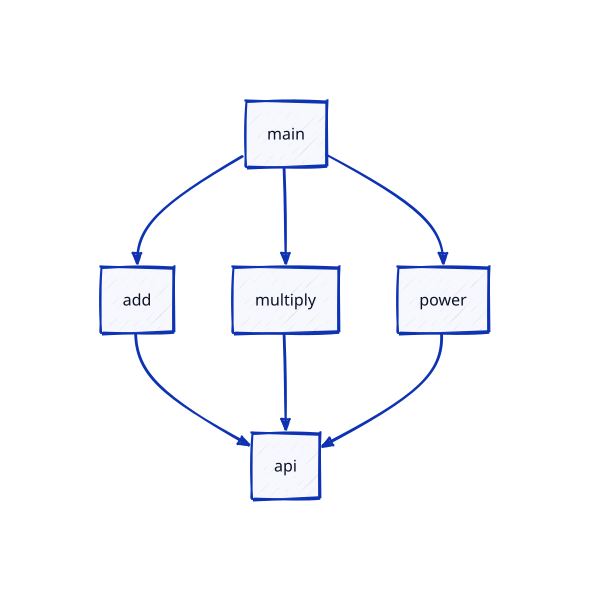

# go-arch-lint

A small Go HTTP server, structured as vertical slices
(`cmd → slices → api`), exposing three math functions as endpoints.
It doubles as a living example of the kind of architecture
the go-arch-lint consistency tool would verify.

Requires Go 1.26+.

## The point: Architecture lint

The project's layering (`cmd → slices → api`, with independent slices) is
declared as rules in [.go-arch-lint.yml](.go-arch-lint.yml) and enforced with
[go-arch-lint](https://github.com/fe3dback/go-arch-lint):

```sh
make tools    # install go-arch-lint (once)
make lint     # check imports against the rules; exits non-zero on violations
```

## Run

```sh
make run          # or: go run ./cmd/calc
```

The server listens on port **9090**.

## Endpoints

All endpoints are `GET` and require both `a` and `b` query parameters
(as float64 values).

| Endpoint    | Computation |
|-------------|-------------|
| `/add`      | `a + b`     |
| `/multiply` | `a * b`     |
| `/power`    | `a ^ b`     |

Success returns `200` with `{"result": <number>}`;
bad or missing arguments return `400` with `{"error": "<message>"}`.
`/power` also returns `400` when the result is NaN or infinite.

### Examples

```sh
curl "http://localhost:9090/add?a=1.5&b=2.5"
# {"result":4}

curl "http://localhost:9090/multiply?a=3&b=4"
# {"result":12}

curl "http://localhost:9090/power?a=2&b=10"
# {"result":1024}
```

## Dependency graph



`make lint` reports violations like *"component `power` shouldn't depend on
`go-arch-lint/slices/add`"* — exactly what happens if a slice starts
importing another slice. The dependency graph above is regenerated with
`make graph` (it writes `go-arch-lint-graph.svg` to the project root).
